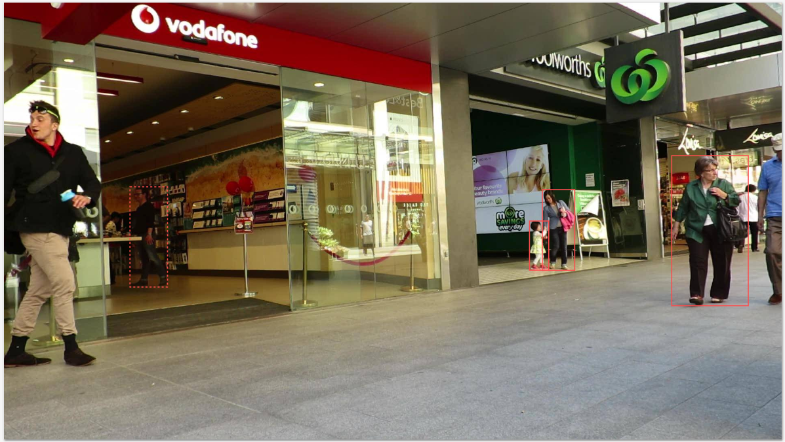
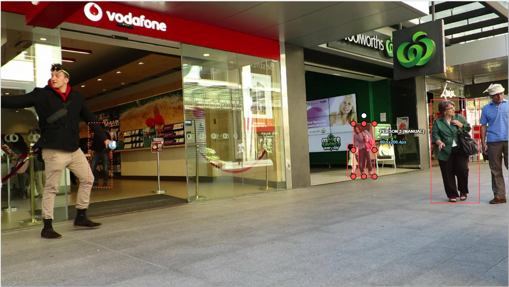
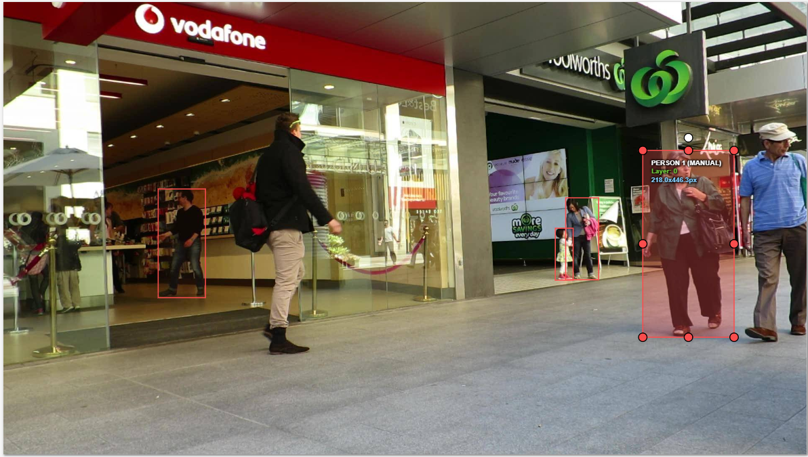
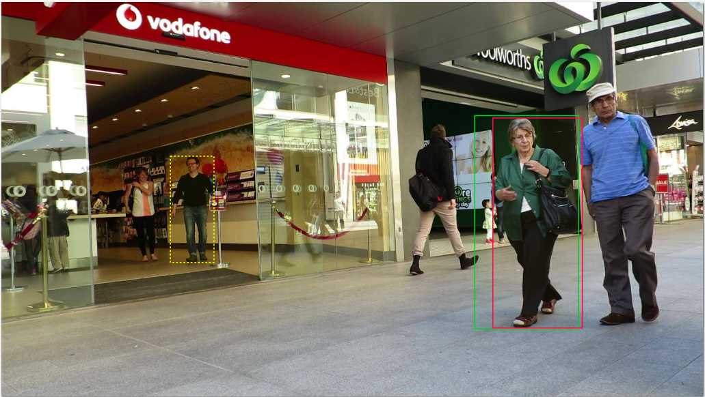

# Báo cáo cá nhân — PhamHai-2A202604047

Đoạn video: MOT17-09, 150 frame (frame 1–150), nguồn MOTChallenge, giấy phép CC BY-NC-SA 3.0.

## 0. Thông tin học viên

- Họ tên: Phạm Hải
- MSSV: 2A202604047
- Mã đề (A/B/C): B
- Email: 26ai.haip@vinuni.edu.vn
- Link repository: https://github.com/PHai237/K5-L2B-DAY05-PhamHai-2A202604047-MOTTracking
- Giờ bắt đầu: 16h30
- Giờ kết thúc: 18h20

## 1. Xem trước đoạn video (CP0)

Ghi **trước khi vẽ**, mỗi người một dòng.

| Mã | Frame xuất hiện | Frame cuối thấy được | Rẽ / dừng / đổi tốc độ ở frame | Bị che ở frame | Ghi chú |
|---|---|---|---|---|---|
| P1 | 0 | 149 | - | - | - |
| P2 | 0 | 149 | - | - | - |
| P3 | 0 | 106 | Dừng ở frame 24 | 89 | - |
| P4 | 0 | 146 | Dừng ở frame 26 | 106 | - |
| P5 | 0 | 149 | Rẽ ở frame 17 | 0 | - |

## 2. Keyframe và thời gian (CP1, CP4)

Số keyframe lấy từ kết quả `src/check_submission.py`, đối chiếu với bản xuất CVAT for video 1.1 mới nhất.

| Mã | Số keyframe | Keyframe ở frame | Số frame có mặt | Keyframe / 100 frame | Thời gian (phút) | Chỗ khó |
|---|---:|---|---:|---:|---|---|
| P1 | 72 | 0, 1, 2, 3, 4, 5, 7, 9, 10, 14, 19, 20, 21, 22, 23, 24, 25, 26, 29, 34, 39, 44, 49, 54, 59, 64, 69, 74, 79, 84, 89, 90, 91, 92, 94, 99, 100, 104, 105, 106, 108, 109, 110, 111, 114, 115, 116, 117, 118, 119, 120, 121, 122, 124, 125, 126, 127, 128, 129, 130, 131, 132, 133, 134, 136, 137, 139, 140, 142, 144, 148, 149 | 150 | 48,0 | 20 | Người di chuyển và thay đổi kích thước box; nhiều keyframe cần điều chỉnh, đặc biệt từ frame 99 trở đi. |
| P2 | 19 | 64, 65, 70, 74, 80, 84, 90, 94, 100, 104, 110, 114, 120, 124, 130, 134, 140, 144, 149 | 86 | 22,1 | 15 | Người ở mép phải khung hình, chỉ có box hiện diện từ frame 64. |
| P3 | 24 | 0, 4, 10, 14, 20, 24, 30, 34, 40, 44, 50, 54, 60, 64, 70, 74, 80, 84, 89, 90, 94, 99, 100, 104 | 106 | 22,6 | 25 | Người mẹ bị che khi đi gần các đối tượng khác; cần kiểm tra cờ occluded/outside. |
| P4 | 27 | 0, 4, 9, 10, 14, 19, 24, 29, 34, 39, 44, 49, 54, 59, 64, 69, 74, 79, 84, 89, 94, 99, 104, 106, 109, 139, 144 | 118 | 22,9 | 25 | Bé gái bị khuất ở frame 110–138, cần giữ đúng ID khi xuất hiện lại. |
| P5 | 39 | 0, 4, 9, 14, 19, 24, 29, 34, 49, 54, 55, 59, 64, 69, 74, 79, 84, 86, 87, 88, 89, 90, 91, 94, 95, 96, 98, 99, 104, 109, 112, 114, 119, 124, 129, 134, 139, 144, 149 | 142 | 27,5 | 25 | Người trong cửa hàng Vodafone có đoạn khuất hoàn toàn ở frame 41–48 và nhiều frame bị che một phần. |
| **Tổng** | **181** | — | **602** | **30,1** | **110** | — |

**Keyframe / 100 frame của cả bài:**

181 ÷ 602 × 100 = **30,1 keyframe / 100 frame**.

**Bạn đặt keyframe nhiều nhất ở người nào? Vì sao?**

P1 — người phụ nữ mặc áo xanh lá — có số keyframe nhiều nhất, với 72 keyframe trên 150 frame, tương đương 48,0 keyframe/100 frame.

Vì người này liên tục tiến gần camera, làm kích thước bounding box tăng dần và vị trí thay đổi. Khi kiểm tra các frame trung gian, nội suy tuyến tính không phải lúc nào cũng theo sát người, nên em phải bổ sung keyframe để điều chỉnh. Đây cũng là người duy nhất trong bài có đủ 150 frame liên tục mà không bị che khuất hoặc ra ngoài khung hình.

## 3. Đoạn bị che (CP2)

Người bị che: `P5`

| Mốc | Frame |
|---|---:|
| Bắt đầu bị che một phần (bật `occluded`) | 0 |
| Mất hẳn (bật `outside`) | 41 |
| Hiện lại (tắt `outside`) | 49 |
| Thấy rõ trở lại (tắt `occluded`) | 55 |

- Thời gian khuất hẳn: 8 frame = 0.27 giây.
- Quyết định: giữ cùng ID.
- Lý do (trả lời 3 câu: khuất bao lâu so với 60 frame, ngoại hình có khớp, chỗ hiện lại có đúng hướng và tốc độ): P5 chỉ khuất 8/60 frame, ngoại hình có khớp và chỗ hiện lại đúng hướng và tốc độ

Ảnh chụp màn hình:





## 4. Tự review ID (CP3)

Lượt 1 theo người (đi ngược từ frame 149 về 0 trên CVAT), lượt 2 theo cảnh (nhảy 10 frame). Ít nhất 3 dòng; không có lỗi thì ghi một dòng "đã kiểm hai lượt, không lỗi".

Loại lỗi dùng đúng một trong 7 mã: `id_switch`, `fragmentation`, `lost`, `merge`, `false_track`, `drift`, `flag`.

| Frame | Mã người | Loại lỗi | Mô tả một câu | Phát hiện ở lượt | Đã sửa? |
|---:|---|---|---|---|---|
| | | | | | |
| | | | | | |
| | | | | | |

Tổng hợp số lỗi theo loại:

| `id_switch` | `fragmentation` | `lost` | `merge` | `false_track` | `drift` | `flag` |
|---:|---:|---:|---:|---:|---:|---:|
| | | | | | | |

Lỗi nào chỉ lượt 2 (theo cảnh) mới thấy, lượt 1 (theo người) không thấy? Vì sao?

...

## 5. File xuất và kết quả tự kiểm (CP4)

| Kiểm tra | Kết quả |
|---|---|
| Tên file MOT 1.1 | `PhamHai_mot.zip` |
| Tên file CVAT for video 1.1 | `PhamHai_cvat_video.zip` |
| Số track ID khác nhau trong `gt/gt.txt` (phải là 5) | 5 — Đạt |
| Frame `outside` không có dòng trong `gt.txt` (đúng / sai) | Đúng |
| Job đã completed trên CVAT máy cá nhân | completed |

Dán phần tóm tắt in ra từ `src/check_submission.py`:

```text
=== Tóm tắt ===
  Lỗi: 0   |   Cảnh báo: 0
  Đạt. Dán phần tóm tắt này vào báo cáo mục 5.
```

Kết quả tự kiểm: 5 track ID, 602 bounding box hợp lệ và 181 keyframe, tương đương 30,1 keyframe/100 frame có mặt.

Script không phát hiện lỗi hoặc cảnh báo về cấu trúc dữ liệu xuất.

## 6. Ba câu kết

1. Nếu được gán lại, bạn sẽ đặt keyframe khác ở đâu? Vì sao?

   ...

2. Có chỗ nào bạn không chắc "cùng ID hay ID mới"? Bạn đã quyết định và ghi chú thế nào?

   ...

3. Một lỗi ID trong job của bạn (nếu không còn sót, chọn lỗi đã sửa) có thể làm xe tự lái dự đoán sai chuyển động của người đó như thế nào? Lỗi đó ảnh hưởng MOTA hay IDF1 nhiều hơn?

   ...

## Bonus (nếu làm)

### B1 — Hai người đi sát

...

### B2 — So cách đặt keyframe

Người được chọn: P1 — người phụ nữ mặc áo khoác xanh lá (Track ID 0 trong CVAT).

| Cách đặt | Số keyframe | Frame trôi nhất | Ghi chú |
|---|---:|---:|---|
| Đều mỗi 30 frame | 6 | 104 | Đặt keyframe tại 0, 30, 60, 90, 120, 149. Box nội suy sai khác rõ nhất so với track chính tại frame 104. |
| Theo chuyển động của đối tượng | 72 | 104 (mốc đối chiếu) | Bổ sung keyframe để điều chỉnh sự thay đổi vị trí và kích thước bounding box khi người tiến gần camera. |

**Kết quả so sánh:**

Track thử nghiệm có 6 keyframe, trong khi track chính có 72 keyframe trên cùng 150 frame.

Khi đối chiếu bounding box của hai track, frame 104 có mức sai khác lớn nhất, với IoU giữa hai box khoảng 0,785. Cạnh trái của box thử nghiệm lệch khoảng 50 pixel so với box chính.

P1 xuất hiện liên tục trong cả 150 frame, không bị che khuất và không có trạng thái `outside`. Vì vậy, phép so sánh tập trung vào sự khác biệt trong nội suy vị trí và kích thước bounding box.

**Giải thích:**

P1 di chuyển dần về phía camera, làm kích thước bounding box tăng lên theo thời gian do hiệu ứng phối cảnh.

Trong khi đó, CVAT nội suy tuyến tính giữa hai keyframe, giả định tọa độ và kích thước box thay đổi đều. Giả định này không hoàn toàn phù hợp khi kích thước biểu kiến của người tăng theo chuyển động tiến gần camera.

Vì vậy, cách đặt keyframe mỗi 30 frame có thể tạo ra sai lệch ở các frame trung gian. Cách đặt keyframe theo chuyển động giúp hiệu chỉnh box tốt hơn, đổi lại cần nhiều thao tác gán nhãn hơn.

**Ảnh minh chứng:** 

### B3 — So với tracker có sẵn

| Frame | Mã người | Tracker làm gì | Nhãn của bạn | Giải thích (đoán rồi sửa / ghép IoU / box score thấp / ngoại hình) |
|---:|---|---|---|---|
| | | | | |
| | | | | |

## 7. Tài liệu tham khảo và công cụ AI đã dùng

**Tài liệu tham khảo:**

- MOTChallenge — MOT17 Dataset, Milan et al. (2016), giấy phép CC BY-NC-SA 3.0.
- Tài liệu Lab Ngày 5: `README.md`, `RULES.md`, `CHECKPOINTS.md`, `RUBRIC.md`, `docs/GUIDELINE.md`.
- Công cụ gán nhãn CVAT Community và script `src/check_submission.py`.

**Công cụ AI đã sử dụng:**

- ChatGPT (OpenAI): Hỗ trợ giải thích cách sử dụng CVAT, keyframe, nội suy tuyến tính, trạng thái `occluded` và `outside`; hỗ trợ phân tích kết quả xuất dữ liệu, đọc kết quả script tự kiểm và chỉnh sửa cách trình bày báo cáo.
- Việc vẽ bounding box, đặt keyframe, theo dõi đối tượng và quyết định giữ Track ID được thực hiện thủ công trên CVAT.
